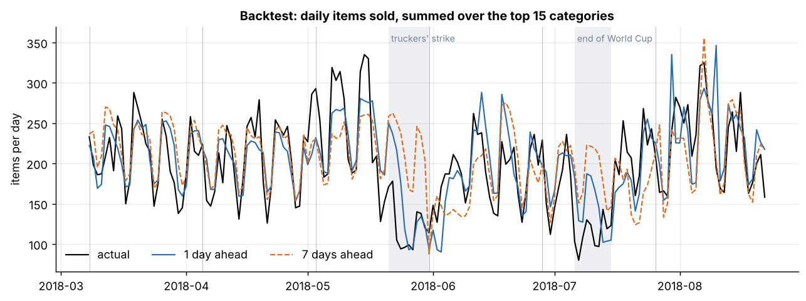
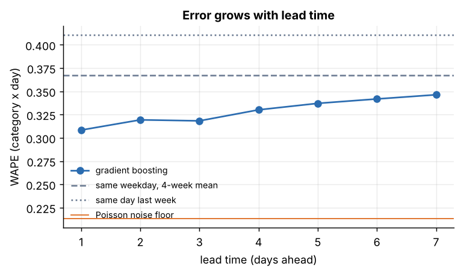
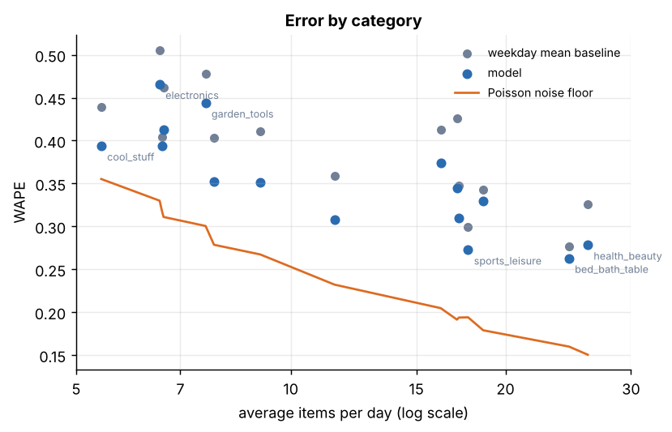
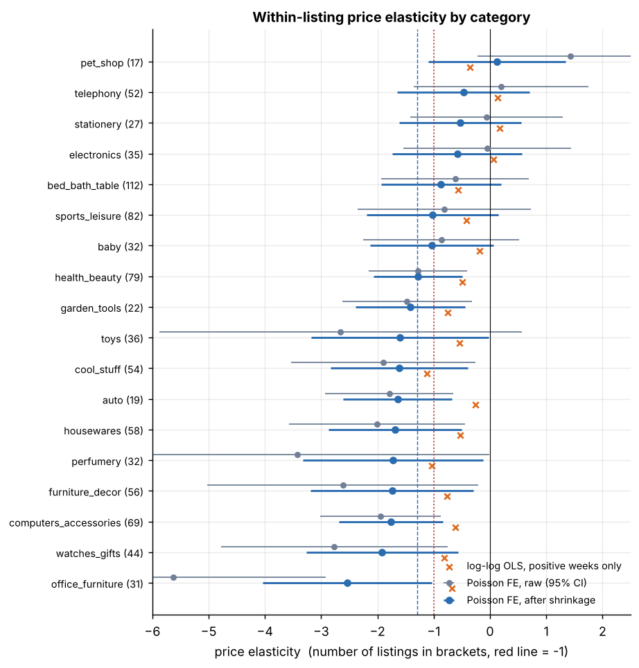
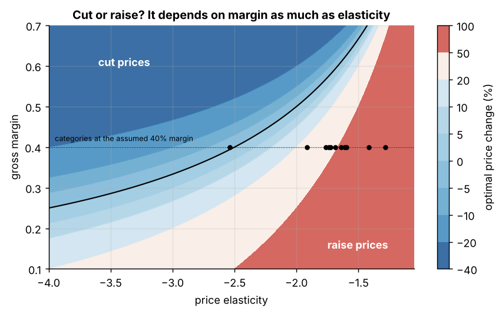
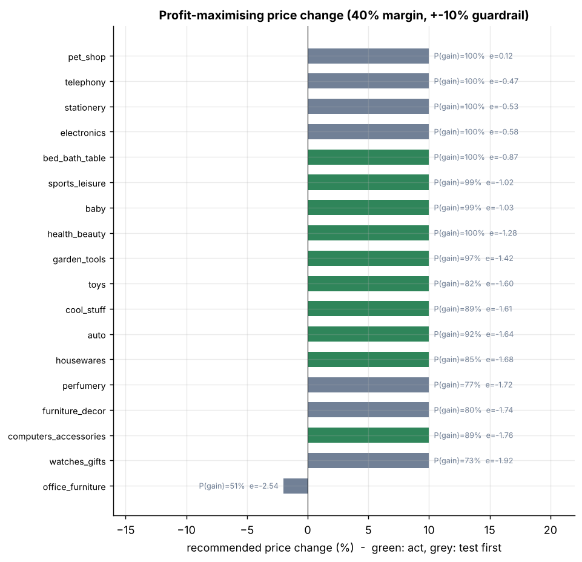
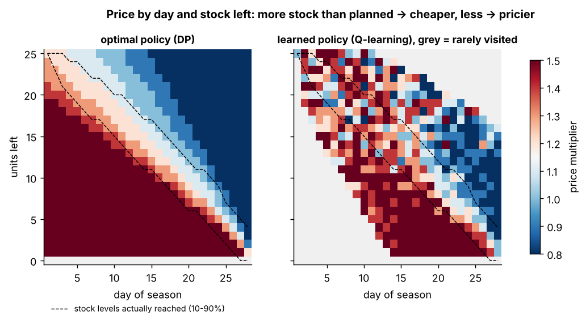
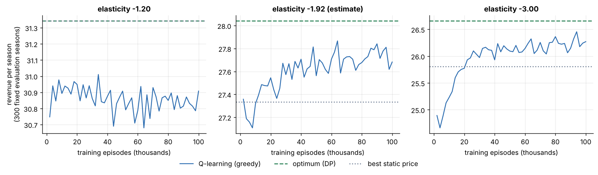
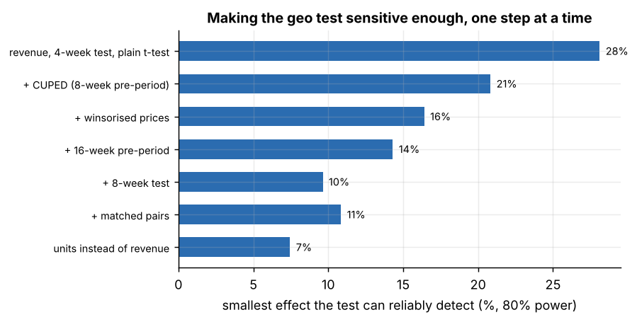

# Dynamic pricing on the Olist e-commerce data

An end-to-end pricing project on ~100k real orders from Olist, a Brazilian online marketplace.
It covers four pieces that depend on each other:

1. **Demand forecasting**: daily sales per category, 1-7 days ahead
2. **Price elasticity**: how much sales drop when a seller raises the price
3. **Pricing decisions**: a constrained profit-maximising price change, plus a reinforcement
   learning agent that prices a limited stock over a season
4. **Experiment design**: how to test a price change properly, and how big a change a test
   on this data can actually detect

I tried to keep it honest. Some of the results are smaller than the big uplift numbers you
often see in pricing demos, and I'd rather explain why than hide it.

At Powea I worked on an RL model that scheduled EV charging around changing electricity
prices, so I was reacting to prices. Here I wanted to try the other side of the problem:
*setting* prices, and finding out how far you can get with observational data before you need
an experiment.

## Main results

| | result |
|---|---|
| Forecast | WAPE **0.33** vs 0.37 for the best simple baseline (-10%); 0.31 at 1 day ahead. The biggest misses are two outside events: the May 2018 truckers' strike and the end of the 2018 World Cup |
| Elasticity | Weeks with zero sales matter. Dropping them (the usual log-log regression) makes demand look inelastic (**-0.4**). Keeping them (Poisson regression with fixed effects) gives **-1.3** on average, from -2.5 to about -0.5 depending on the category |
| Pricing | With an assumed 40% margin, 10 of 18 categories get a confident **+10%** (the guardrail), with an expected profit gain of ~10%. The other 8 are sent to testing because the estimate is too noisy |
| RL | Q-learning reaches **98.7%** of the true optimum (exact dynamic programming), **+1.2%** revenue over the best fixed price (the optimum gets +2.6%). The gain shrinks as stock gets bigger |
| A/B test | A geo test on this data **can't see a 2-3% revenue change** (smallest detectable ~11%). It can measure the drop in units (~8%), and that's enough to pin down the elasticity |

## Data

[Brazilian E-Commerce Public Dataset by Olist](https://www.kaggle.com/datasets/olistbr/brazilian-ecommerce)
(Kaggle). After cleaning: **111,186 items in 97,408 orders**, 1 Jan 2017 to 22 Aug 2018.
Before 2017 there are almost no orders, and after 22 Aug 2018 the export stops, so I cut both ends.
Details and download instructions are in [data/README.md](data/README.md). The first look at
the data is in [notebooks/01_eda.ipynb](notebooks/01_eda.ipynb).

## 1. Demand forecasting

**Setup.** Daily items sold for the 15 largest categories (79% of all items).
One global gradient boosting model (scikit-learn `HistGradientBoostingRegressor`) for all
categories, and one model per lead time (1 to 7 days ahead). A few details that mattered:

- **Poisson loss**, because the target is a small daily count
- the target is **divided by the category's recent 28-day level**, so patterns learned on big
  categories carry over to small ones. In my tests this lowered WAPE by 0.003-0.008
- **multivariate inputs**: own lags, rolling means, price index, number of active sellers,
  freight, platform-wide volume, calendar and Brazilian holidays
- **no leakage**: a lead-h model only sees data up to h days before the day it predicts.
  `tests/test_features.py` checks this by scrambling the last h days and confirming the
  features don't change

**Evaluation.** Rolling-origin backtest over the last 6 x 28 days (March to August 2018). The
models are retrained at the start of each fold.

| | WAPE (category x day) | WAPE (platform total) |
|---|---|---|
| same day last week | 0.410 | 0.202 |
| same weekday, mean of last 4 weeks | 0.367 | 0.205 |
| **gradient boosting, all leads** | **0.329** | **0.174** |
| gradient boosting, 1 day ahead | 0.308 | |
| gradient boosting, 7 days ahead | 0.346 | |



**Error analysis.**
- **The two worst stretches are outside events.** 21-31 May 2018 was the nationwide
  truckers' strike in Brazil: sales roughly halved and the 7-day forecast was 2-2.5x too high on the worst days.
  6-15 July lines up with the end of the World Cup (Brazil went out on 6 July, the final was on
  15 July). I can't prove the World Cup caused it from this data alone, but no model with these
  inputs could have seen either event coming. The week *after* each shock is under-forecast,
  because the lag features still remember the dip.
- **Small categories are mostly noise.** If demand were Poisson around a perfect forecast, the
  WAPE would still be 0.21 on average and 0.30-0.36 for categories selling 5-7 items a day.
  The model is close to that floor for small categories and has more room on big ones.
- **Fridays and Saturdays are over-forecast by ~8%**, and it's consistent from March to July. My
  guess is that the weekday pattern shifted in 2018 compared to 2017, which most of the training
  data comes from. A "recent weekday share" feature would be my next thing to try.

 

The model also writes the forecast for the 7 days after the data ends
(`outputs/forecast_next_7_days.csv`), which the API serves.

## 2. Price elasticity

**Question:** if a seller raises the price of a listing by 1%, by what % do its sales change?

**Unit:** a listing (one product sold by one seller) in one week. Only listings that sold in at
least 8 weeks and whose price actually moved are used: **994 listings, 43,919 listing-weeks.**

**Model** (`pricing/elasticity.py`), per category:

```
E[units] = exp( elasticity * log(price) + b * log(1 + freight) + listing effect + week effect )
```

- the **listing effect** means a listing is only compared with itself, so "expensive products
  sell less" (a difference *between* products) doesn't leak into the estimate
- the **week effect** removes anything that hits every listing in the same week (Black Friday,
  the strike, platform growth)
- standard errors are clustered by listing
- category estimates are noisy, so they are **shrunk towards the overall mean** with an
  empirical Bayes (random effects) step. Noisier categories get pulled harder

**Why Poisson and not log-log OLS.** 66% of listing-weeks have *zero* sales. log(0) is
undefined, so the usual log-log regression drops those weeks, which removes exactly the weeks
where a high price meant nobody bought. On this data that matters a lot:

| method | mean elasticity |
|---|---|
| log-log OLS, positive weeks only (pooled) | -0.51 (se 0.07) |
| log-log OLS, positive weeks only (random-effects mean over categories) | -0.42 (se 0.08) |
| **Poisson with fixed effects, zero weeks included (main)** | **-1.29** (se 0.28) |

`tests/test_elasticity.py` reproduces this on synthetic data with a known elasticity of -1.5:
the Poisson model recovers it and OLS on positive weeks is biased towards zero.



After shrinkage, categories range from -2.5 (office furniture) to around -0.5 for electronics,
stationery and telephony, and pet shop even comes out slightly positive. Those last four are
probably *not* really price-insensitive.
More likely the data has too little clean price variation there to measure anything, and the
next step treats them that way.

## 3. Price recommendations

With constant elasticity *e* and gross margin *m*, changing the price by a factor *r* changes
profit by a factor `((r - 1 + m) / m) * r^e`. For each category I:

1. draw 4,000 elasticities from its estimate and standard error,
2. pick the price change in [-10%, +10%] with the best **expected** profit,
3. act only if P(profit goes up) >= 80% **and** P(elasticity < 0) >= 90%; otherwise
   "test first".

Olist has no cost data, so **the 40% margin is an assumption**, and it matters as much as the
elasticity. Cutting prices only pays if demand is more elastic than about -2.5 at a 40% margin:



**Result:** 10 of 18 categories get a confident +10%: expected profit **+9.7%**, revenue -3.5%,
units -12% on average. Four more are too uncertain, and the four near-zero categories are sent
to testing.



**My honest read:** every confident recommendation sits on the +10% guardrail, so the
guardrail is doing the work, not the model. With these elasticities the unconstrained optimum is
far above today's prices, which I don't believe for a competitive marketplace where buyers can
switch sellers. More likely the estimates are still biased towards zero (see limitations). So
this is a reason to **run an experiment**, not to roll out +10% everywhere.

## 4. Dynamic pricing with reinforcement learning

**Problem:** a seller has a fixed stock and 28 days to sell it, and picks a price every day from
a menu (0.8x to 1.5x the base price). Leftover stock is cleared at 30% of the base price. Demand
is Poisson, with the weekday pattern and the elasticity of the **watches_gifts** category and
the sales rate of its best-selling listing (1.2 units/day, stock = 25 units).

**Agent:** tabular Q-learning. State = (day, units left), reward = revenue. The learning rate
decays per state-action with the number of visits (a fixed learning rate never settled because
of the Poisson noise). 100k simulated seasons.

**Baselines:** the best fixed price for the whole season, and the true optimum, computed exactly
with dynamic programming. That's possible because the simulator's demand model is known; the
agent never sees it.

| elasticity | best fixed price | Q-learning | optimum (DP) | Q-learning vs fixed | optimum vs fixed |
|---|---|---|---|---|---|
| -1.20 | 31.34 (1.5x) | 31.05 | 31.34 | -0.9% | 0.0% |
| **-1.92 (estimate)** | 27.33 (1.2x) | 27.67 | 28.04 | **+1.2%** | +2.6% |
| -3.00 | 25.81 (1.1x) | 26.24 | 26.66 | +1.7% | +3.3% |

(expected revenue per season, base price = 1; computed exactly, not simulated)



The learned policy has the same shape as the optimal one: cheaper when there's more stock left
than planned, more expensive when there's less. It's only reliable in the states it actually
visits (the grey area is states it rarely saw). It captures about half of the possible gain over
a fixed price.

What I took from it:
- **If demand is inelastic, there's nothing to learn**: the highest price on the menu is already
  optimal, and exploring only costs money (first row).
- **Dynamic pricing matters most for small stocks.** With 12 units the optimum beats the best
  fixed price by 3.1%, with ~400 units only by 1.2%. With large stock, demand is predictable and
  one good price is almost as good. Part of the remaining gain at scale comes from alternating
  between two neighbouring menu prices.
- **Sample efficiency is the real problem.** 100k seasons is fine in a simulator but impossible
  in real life. The simulator is only as good as the elasticity it's built on, which brings us
  back to section 2 and to testing.



## 5. Designing the price test

Showing different prices to different users at the same time on the same site is a bad idea
(fairness, and customers compare), so price tests usually **randomise regions**. I used 3-digit
zip prefixes: 578 regions with enough orders, and none bigger than 1.4% of revenue. With cities,
Sao Paulo alone is 15%.

Olist has no traffic data and no real experiment, so everything below is done by simulation on
top of the real order data:

**A/A tests first.** 2,000 random splits with no treatment. All designs reject 4.2-5.0% of the
time at alpha = 5%, so the tests are calibrated.

**Then the noise.** The smallest effect a test can detect (80% power) is about 2.8x the spread
of the A/A estimates. Starting from a naive 4-week revenue test:



- **CUPED** (adjusting for each region's pre-period sales) and **winsorising** a few very
  expensive orders are the big wins
- a longer pre-period and an 8-week test help a lot
- **matched pairs made it slightly worse**. Pairing on pre-period revenue doesn't add anything
  once CUPED already uses it, and the paired test loses degrees of freedom. So I kept the simpler
  design
- **units are much less noisy than revenue**

Final design: 8-week test, 16-week pre-period, random split + CUPED. **Smallest detectable
change: ~8% in units, ~11% in revenue.**

**What that means:** a +10% price change with elasticity -1.3 moves revenue by about -3%. The
test can't see that. It *can* see the ~-12% in units, and units are what you need to estimate
the elasticity, which gives you the profit effect. So the test should be designed to measure the
**volume response**, not to "detect a revenue lift".

**One simulated run** (+10% price in half of the regions, true elasticity -1.29):

| metric | measured effect | 95% CI | true effect |
|---|---|---|---|
| units | -10.6% | [-15.6%, -5.7%] | -11.6% |
| revenue | +1.2% | [-5.7%, +8.2%] | -2.8% |
| gross profit | +14.7% | [+7.2%, +22.2%] | +10.5% |

Elasticity implied by the units result: **-1.18 [-1.78, -0.61]**, consistent with the true
-1.29. The revenue estimate even has the wrong sign, which is exactly why it shouldn't be the
decision metric.

## Engineering

- **One command runs everything:** `python run_pipeline.py` (a few minutes on a laptop), or
  one step with `--step forecast|elasticity|optimize|rl|abtest`
- **Config:** every number above comes from `config.yaml` (seeds, windows, model settings,
  margin, guardrail)
- **Run log:** every step appends its parameters, metrics and git commit to
  `outputs/runs.jsonl`. If `mlflow` is installed and `MLFLOW_TRACKING_URI` is set, runs also go
  to MLflow
- **Tests:** 31 pytest tests on synthetic data (no Kaggle download needed): leakage checks,
  recovering a known elasticity, DP vs simulation, A/A calibration, API. They run on GitHub
  Actions for every push
- **API:** FastAPI on top of the pipeline outputs, plus a Dockerfile

```bash
uvicorn api.app:app --reload        # docs at http://127.0.0.1:8000/docs

curl -X POST http://127.0.0.1:8000/price/recommend \
     -H "Content-Type: application/json" \
     -d '{"category": "health_beauty", "current_price": 89.90}'
# -> {"recommended_price": 98.89, "recommended_change": 0.1, "prob_profit_gain": 0.996,
#     "action": "change price", ...}
# for a "test first" category the current price is kept and candidate_price is the one to test

curl http://127.0.0.1:8000/forecast/health_beauty
```

## How to run

```bash
git clone https://github.com/nazlicanparali/dynamic-pricing.git
cd dynamic-pricing
python -m venv .venv
.venv\Scripts\activate            # Windows  (macOS/Linux: source .venv/bin/activate)
pip install -r requirements.txt

# put the Olist CSVs in data/raw/ (see data/README.md), then:
python run_pipeline.py
pytest
```

Python 3.10+. The outputs and figures in this repo come from the default `config.yaml`.

## Project structure

```
pricing/
  data.py           loading + cleaning, daily and weekly panels
  features.py       lag/rolling/calendar features (leak-free per lead time)
  forecasting.py    per-lead gradient boosting, backtest, error analysis
  elasticity.py     Poisson FE + OLS comparison, empirical Bayes shrinkage
  optimization.py   profit-maximising price change under uncertainty
  simulator.py      stock-clearing environment + exact DP solution
  rl_agent.py       Q-learning, comparison with DP and fixed price
  ab_testing.py     geo test: A/A, CUPED, power, simulated price test
  tracking.py       run log (+ optional MLflow)
api/app.py          FastAPI service
tests/              pytest suite (synthetic data)
notebooks/          first look at the data
outputs/            CSV/JSON results of the last run
reports/figures/    all figures in this README
config.yaml         every parameter
run_pipeline.py     entry point
```

## Limitations and what I'd do next

- **The elasticities are observational.** Sellers probably cut prices when sales are weak, which
  pulls the estimate towards zero. For zero-sales weeks the price isn't observed, so I carry the
  last price forward, which is also an assumption. A real price test (section 5) is how I'd
  settle it.
- **No cost data.** The 40% margin drives the recommendations as much as the elasticity does.
  With real costs per product, section 3 would be much more useful.
- **Constant elasticity** is a simplification. In a marketplace, what probably matters is the
  price relative to other sellers of similar products, and I don't model competitors at all.
- **The RL simulator is simple.** One listing, no competitors, no restocking, and demand that
  doesn't depend on past prices. The point was to compare Q-learning with a known optimum, not to
  build a realistic market.
- **Forecast:** a recent-weekday-share feature (for the Friday/Saturday bias), and quantile
  regression for proper prediction intervals instead of the Poisson approximation.
- **Geo test:** neighbouring zip regions can influence each other (people see prices from
  another region). Bigger units or a switchback design (alternating prices over time) would be
  worth comparing.
